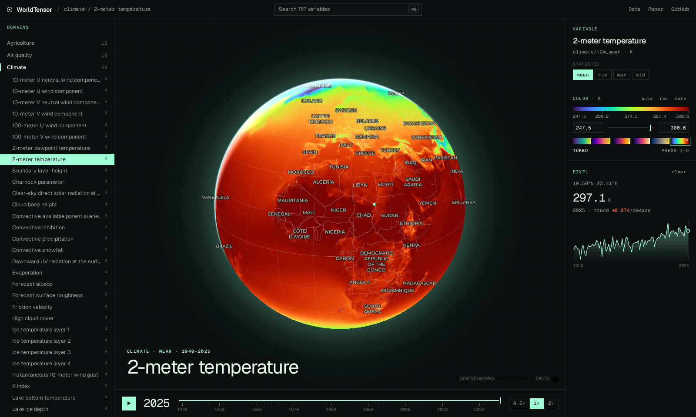
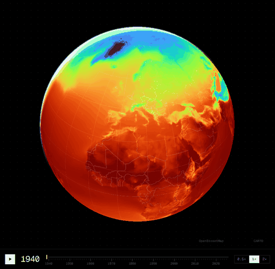
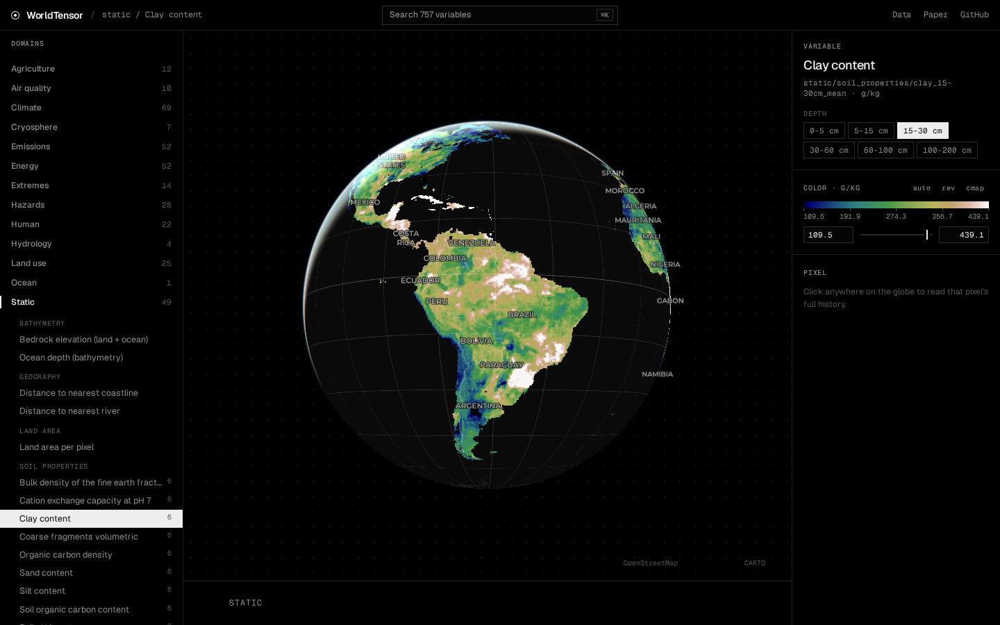

# WorldTensor GeoZarr

**757 harmonized Earth-system variables (1900–2025, 0.25°) as one cloud-native GeoZarr store, with a WebGL globe viewer that streams it directly from object storage.**

**[Open the viewer →](https://research.taylorgeospatial.org/worldtensor-geozarr/)** · Data: `https://data.source.coop/tge-labs/worldtensor/worldtensor.zarr` · [Paper](https://arxiv.org/abs/2607.03298) · [Original release (Zenodo)](https://zenodo.org/records/19047618)



This repo converts the [WorldTensor](https://arxiv.org/abs/2607.03298) NetCDF release into a single GeoZarr store on [Source Cooperative](https://source.coop) and serves a static viewer for it. There is no tile server: the browser reads Zarr chunks over HTTP range requests.

## Use the data

```python
import xarray as xr

ds = xr.open_zarr("https://data.source.coop/tge-labs/worldtensor/worldtensor.zarr/climate/t2m_mean")
ds.t2m_mean.sel(time="2025", lat=48.85, lon=2.35, method="nearest")  # Paris, K
```

Each variable is its own group (`<domain>/<variable>`, e.g. `ocean/chl_max`, `static/soil_properties/bdod_0-5cm_mean`). Opening a group is a single request because its metadata is consolidated. `catalog.json` at the store root lists all 757 variables with their units, years and default colour ranges.

| array | chunks | serves |
|---|---|---|
| `<var>` (721 × 1440) | 1 year × 361 × 360 | full resolution, 8 tiles per year |
| `2x/<var>` | 1 year × whole globe | the global view in one request |
| `4x/<var>`, `8x/<var>` | all years × whole globe | the time slider in one request |
| `ts/<var>` | all years × 16 × 16, one shard | a pixel's full history in about 40 KB |

The store is lossless: float32 with Blosc zstd and byte shuffle, NaN as nodata. The grid is EPSG:4326 cell centres, with latitude ascending from −90 to 90 and longitude running 0 to 359.75.

### GeoZarr

Every group follows CF-1.8: a `spatial_ref` grid mapping with WKT and a GDAL `GeoTransform`, and `grid_mapping` plus `coordinates` on each data array. Each group also carries the zarr-conventions v0.1 [`multiscales`](https://github.com/zarr-conventions/multiscales), [`proj`](https://github.com/zarr-conventions/proj) and [`spatial`](https://github.com/zarr-conventions/spatial) attributes. Overview levels are built by 2× averaging, and they drop the odd 90°N row so that every level is exactly affine. [`bench/geozarr/validate.py`](bench/geozarr/validate.py) checks all 3,028 levels against the official schemas, against the coordinate arrays and against rioxarray; it currently reports 0 errors.

## Viewer

<p>
  
  
</p>

The viewer uses Vite, TypeScript, a MapLibre globe and deck.gl-raster's [`ZarrLayer`](https://github.com/developmentseed/deck.gl-raster).

- **Time playback:** each variable draws two layers. The 8× overview holds every year in one GPU texture, so playing or scrubbing through time makes no network requests. Once you pause, a full-resolution layer fetches the year you're on.
- **No metadata requests:** array metadata comes from `catalog.json`, and chunk bytes are deduplicated and cached in memory.
- **Hover** reads the exact pixel value. **Clicking** reads that pixel's whole history from the sharded `ts` array and plots it with a trend per decade.

```bash
cd web && npm install
WT_DATA=/path/to/worldtensor.zarr npm run dev                                         # local store at /data
VITE_DATA_URL=https://data.source.coop/tge-labs/worldtensor/worldtensor.zarr npm run build
```

## Pipeline

SLURM scripts in [`pipeline/`](pipeline/) run download → extract → manifest → convert → pyramid and `ts` → GeoZarr metadata, consolidation and catalog. [`bench/`](bench/) holds the codec, chunking and validation benchmarks behind the layout choices.

## Citation

If you use this data, please cite the WorldTensor paper and the original data release:

```bibtex
@article{rodriguezpardo2026worldtensor,
  title   = {A harmonised dataset for Earth system foundation models},
  author  = {Rodriguez-Pardo, Carlos and Tavoni, Massimo},
  journal = {arXiv preprint arXiv:2607.03298},
  year    = {2026}
}

@dataset{rodriguezpardo2026worldtensor_data,
  title     = {Data for WorldTensor: A Harmonized Dataset for Earth System Foundation Models},
  author    = {Rodriguez-Pardo, Carlos and Tavoni, Massimo},
  year      = {2026},
  publisher = {Zenodo},
  doi       = {10.5281/zenodo.19047618},
  url       = {https://zenodo.org/records/19047618}
}
```

The data is redistributed under the original release's [CC BY 4.0](https://creativecommons.org/licenses/by/4.0/) license. Values, units and variable semantics are unchanged from the source; only the format and layout differ.
